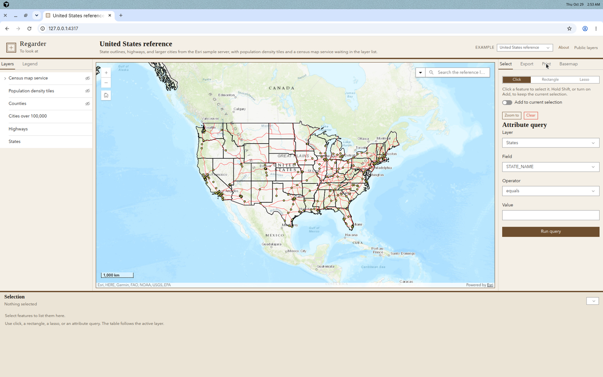
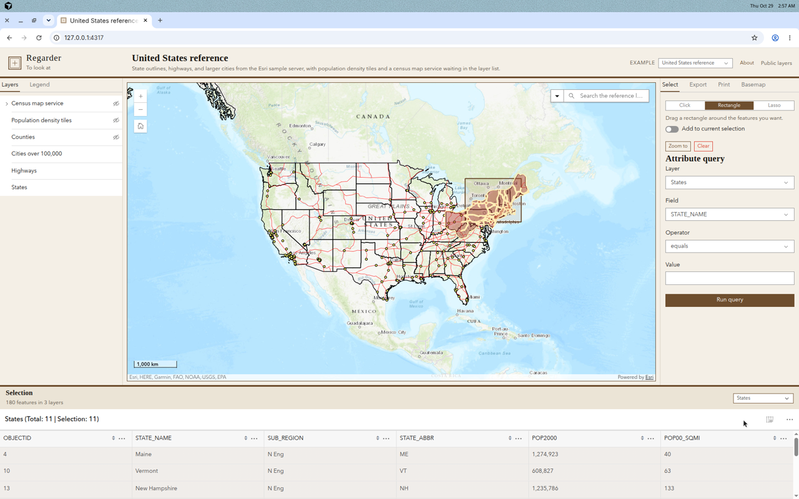
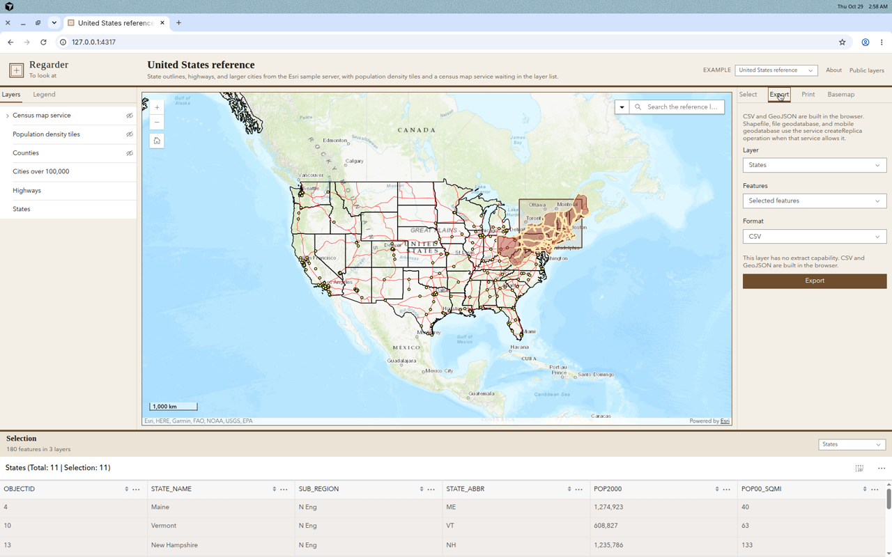
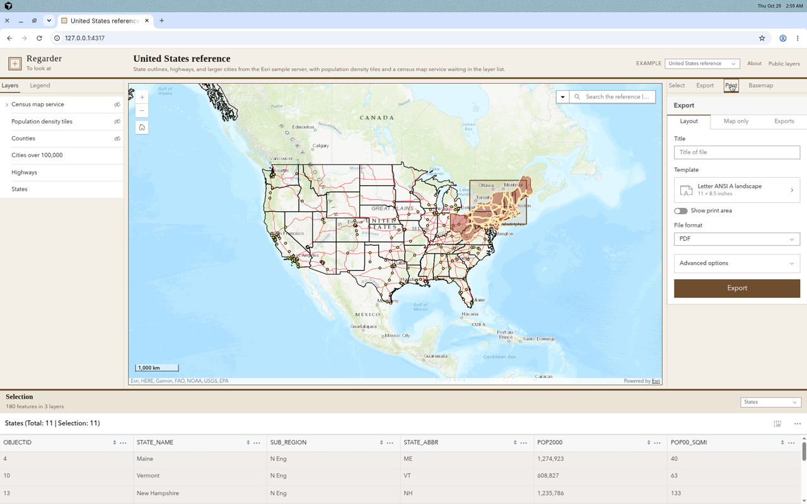

# Regarder

Regarder is French for "to look at." This is a viewer you point at a map configuration and use to
look at the data: layers, a selection, an export, a print.

Regarder is built with Vite, TypeScript, and the ArcGIS Maps SDK for JavaScript 4.34. Map components
and the Calcite design system provide the map, the layer list, the legend, search, the basemap
gallery, print, and the feature table. There is no backend. A new deployment is a new config file.

[](CHANGELOG.md)
[](LICENSE)
[](https://developers.arcgis.com/javascript/latest/)
[](https://www.typescriptlang.org/)
[](.github/workflows/ci.yml)



## Features

- One JSON file describes the title, portal, basemap, extent, and every layer.
- Layer types: feature service, map image service, vector tile, web map item, GeoJSON, and CSV.
- Per-layer title, visibility, opacity, scale range, definition expression, popup fields, selection,
  and export fields.
- Sign-in modes: public, ArcGIS OAuth (the path ArcGIS Online and ArcGIS Enterprise use for SAML and
  enterprise logins), and Integrated Windows Authentication for an intranet portal.
- Select by click, rectangle, or lasso, or by an attribute query. Results are highlighted and listed
  in a feature table.
- Export the selection, or the whole filtered layer, to CSV and GeoJSON. When the feature service
  supports it, also request a shapefile, file geodatabase, or mobile geodatabase through
  `createReplica`.
- Print through a configurable print service, with layout and format choices. The default is the
  public Esri print service.
- Layer list, legend, search against your layers, basemap gallery, home, and zoom.
- Responsive layout for a desktop map desk and a phone.

## Screenshots

| Map                                                                           | Selection                                                                            |
| ----------------------------------------------------------------------------- | ------------------------------------------------------------------------------------ |
|  |  |
| Export                                                                        | Print                                                                                |
|     |                        |

## Quick start

Requirements: Node.js 20 or newer.

```bash
npm install
npm run dev
```

Open the URL Vite prints. The dev server uses port **4317**.

The app loads configuration in this order:

1. `?config=<id>`, for example `http://127.0.0.1:4317/?config=natural-hazards`
2. `public/config.json`, if you have created one (it is gitignored)
3. The `default` entry in `public/configs/index.json`

Two examples ship with the repo and use public services that do not require a login:

| Id                | What it shows                                                                                                                                                                              |
| ----------------- | ------------------------------------------------------------------------------------------------------------------------------------------------------------------------------------------ |
| `usa-reference`   | States, highways, and cities from the Esri sample server, plus population-density vector tiles and a census map service in the layer list                                                  |
| `natural-hazards` | Earthquakes since 1970, Atlantic hurricane tracks, a live USGS GeoJSON feed, a local CSV of field sites, a sync-enabled feature service for file-geodatabase extract, and a public web map |

Use the example menu in the header to switch between them.

## Make it yours

```bash
cp config.example.json public/config.json
```

Edit `public/config.json`. Restart is not required for a static server; refresh the browser.
`npm run dev` serves `public/` as the site root, so the file is picked up on refresh.

`config.example.json` lists every option. Values such as `YOUR_CLIENT_ID` are placeholders. Do not
commit `public/config.json` or a real client ID.

### Add or swap a layer

Add an object to `layers`. `id` must be unique and start with a letter. `type` is one of `feature`,
`map-image`, `vector-tile`, `webmap`, `geojson`, or `csv`.

```json
{
  "id": "cities",
  "title": "Cities over 100,000",
  "type": "feature",
  "url": "https://sampleserver6.arcgisonline.com/arcgis/rest/services/USA/MapServer/0",
  "visible": true,
  "selectable": true,
  "definitionExpression": "pop2000 > 100000",
  "popupFields": [
    { "field": "areaname", "label": "City" },
    { "field": "pop2000", "label": "Population, 2000", "format": "number" }
  ],
  "exportableFields": ["areaname", "st", "capital", "pop2000"]
}
```

A feature layer URL can point at a feature service (`.../FeatureServer/0`) or at a queryable
map-service layer (`.../MapServer/0`). Only a feature service can produce a geodatabase or
shapefile. Map-service layers, GeoJSON, and CSV still export to CSV and GeoJSON in the browser.

To retire a layer, delete its object. To restyle the popup or the download, change `popupFields` and
`exportableFields` only. Geometry is always included in an export; `exportableFields` limits the
attributes. Omit `exportableFields` to export every attribute.

## Configuration reference

### App

| Property             | Required | Description                                                                                                                                                                                                           |
| -------------------- | -------- | --------------------------------------------------------------------------------------------------------------------------------------------------------------------------------------------------------------------- |
| `title`              | yes      | Name shown in the header and the browser tab.                                                                                                                                                                         |
| `description`        | no       | Sentence under the title and in the About dialog.                                                                                                                                                                     |
| `branding.name`      | no       | Wordmark. Defaults to Regarder.                                                                                                                                                                                       |
| `branding.tagline`   | no       | Line under the wordmark.                                                                                                                                                                                              |
| `branding.accent`    | no       | Hex color, such as `#6e4e2e`.                                                                                                                                                                                         |
| `theme`              | no       | `light` (default) or `dark`.                                                                                                                                                                                          |
| `portalUrl`          | no       | Portal home, without `/sharing`. Defaults to `https://www.arcgis.com`.                                                                                                                                                |
| `basemap`            | no       | A basemap id string (`"osm"`, `"topo-vector"`) or `{ "title", "id", "url" }`. A `url` is a tiled map service and does not need an API key. Premium vector styles such as `streets-vector` need `VITE_ARCGIS_API_KEY`. |
| `basemapGallery`     | no       | Same shape as `basemap`, as an array. The default gallery is the classic Esri tiled basemaps (topographic, streets, imagery, light gray, dark gray, oceans, National Geographic).                                     |
| `extent`             | no       | `{ "xmin", "ymin", "xmax", "ymax", "wkid" }`. `wkid` defaults to 4326. Used instead of `center` when both are set.                                                                                                    |
| `center`             | no       | `[longitude, latitude]`.                                                                                                                                                                                              |
| `zoom`               | no       | 0–23. Used with `center`.                                                                                                                                                                                             |
| `printServiceUrl`    | no       | Export Web Map task. Defaults to the public Esri Printing Tools service.                                                                                                                                              |
| `webMapItemId`       | no       | When set, this web map becomes the map, including its basemap. `layers` are added on top. `extent` still overrides the saved extent.                                                                                  |
| `ui.exampleSwitcher` | no       | Show the example menu. Default `false`. The shipped examples turn it on.                                                                                                                                              |

### Authentication

| Property                | Description                                                                                                                                                                                                        |
| ----------------------- | ------------------------------------------------------------------------------------------------------------------------------------------------------------------------------------------------------------------ |
| `auth.mode`             | `none` (default), `arcgis-oauth`, or `iwa`.                                                                                                                                                                        |
| `auth.appId`            | OAuth client ID. Required for `arcgis-oauth`, unless `VITE_ARCGIS_APP_ID` is set. The environment variable wins. The placeholder `YOUR_CLIENT_ID` disables the button.                                             |
| `auth.popup`            | `true` (default) opens a popup and returns through `oauth-callback.html`. `false` redirects the whole page. Redirect is the better choice when browsers block popups or when an identity provider dislikes popups. |
| `auth.popupCallbackUrl` | Override the popup callback. Defaults to `oauth-callback.html` next to the app.                                                                                                                                    |
| `auth.expiration`       | Requested token lifetime in minutes, passed to `OAuthInfo`.                                                                                                                                                        |
| `auth.trustedServers`   | Extra portal or server origins for Integrated Windows Authentication.                                                                                                                                              |

Environment variables, in `.env` (see `.env.example`):

| Variable              | Purpose                                                                                                                                 |
| --------------------- | --------------------------------------------------------------------------------------------------------------------------------------- |
| `VITE_ARCGIS_APP_ID`  | OAuth client ID. Overrides `auth.appId`.                                                                                                |
| `VITE_ARCGIS_API_KEY` | ArcGIS location API key. Needed only for the World Geocoding Service (`search.includeDefaultSources: true`) or a premium basemap style. |

### Search

| Property                       | Description                                                                                   |
| ------------------------------ | --------------------------------------------------------------------------------------------- |
| `search.enabled`               | Default `true`.                                                                               |
| `search.includeDefaultSources` | Default `false`. `true` adds the ArcGIS World Geocoding Service, which needs an API key.      |
| `search.placeholder`           | Hint when more than one source is available.                                                  |
| `search.layerSources`          | `{ "layerId", "searchFields", "displayField", "placeholder" }`. `layerId` must match a layer. |

### Layers

| Property                          | Description                                                                                                                                                                                              |
| --------------------------------- | -------------------------------------------------------------------------------------------------------------------------------------------------------------------------------------------------------- |
| `id`                              | Unique id. Letters, numbers, hyphens, underscores. Must start with a letter.                                                                                                                             |
| `title`                           | Name in the layer list, popups, and export filenames.                                                                                                                                                    |
| `type`                            | `feature`, `map-image`, `vector-tile`, `webmap`, `geojson`, or `csv`.                                                                                                                                    |
| `url`                             | Required except for `webmap`. `https://` URL, or a relative path such as `./data/sites.csv`. `http://` is accepted only for `localhost` and `127.0.0.1`.                                                 |
| `itemId`                          | Portal item id. Required for `webmap`.                                                                                                                                                                   |
| `visible`                         | Default `true`.                                                                                                                                                                                          |
| `opacity`                         | 0–1. Default 1.                                                                                                                                                                                          |
| `minScale`, `maxScale`            | Layer scale range. `0` means no limit.                                                                                                                                                                   |
| `definitionExpression`            | SQL filter applied by the layer. Selection and "entire layer" export both honor it.                                                                                                                      |
| `popupFields`                     | `[{ "field", "label", "format" }]`. `format` is `number`, `number-2`, or `date`. Omit to keep the service popup, or to build one from the first fields.                                                  |
| `selectable`                      | Click, sketch, and attribute selection. Default `true` for feature, GeoJSON, CSV, and web map layers. Ignored on map image and vector tile layers. A web map layer selects the feature layers inside it. |
| `exportableFields`                | Attribute names for CSV, GeoJSON, and replica output fields. Omit to export every attribute. Geometry is always included (longitude, latitude, and WKT in CSV; GeoJSON geometry otherwise).              |
| `sublayers`                       | Map image only. `{ "id", "title", "visible", "opacity", "definitionExpression" }`. Unlisted sublayers keep the service defaults.                                                                         |
| `latitudeField`, `longitudeField` | CSV columns. Default `latitude` and `longitude`.                                                                                                                                                         |
| `delimiter`                       | CSV delimiter.                                                                                                                                                                                           |
| `copyright`                       | Attribution stored on the layer.                                                                                                                                                                         |
| `pointStyle`                      | Simple marker for a point layer: `color`, `size`, `outlineColor`, and an optional size visual variable (`sizeField`, `minDataValue`, `maxDataValue`, `minSize`, `maxSize`).                              |

A `webmap` layer loads that item's operational layers into a group. It does not replace the basemap.
Use `webMapItemId` when the web map should be the whole map.

## Sign-in, OAuth, and SAML

ArcGIS Online and ArcGIS Enterprise do not need a SAML library in this app. The portal is the OAuth
authorization server. If the organization has a SAML identity provider, the portal login sends the
user to that provider. Regarder only starts the portal's OAuth 2.0 flow (`OAuthInfo` +
`IdentityManager`, authorization code with PKCE). The app never sees the SAML assertion. It receives
an ArcGIS token.

Set this once the portal has a client ID:

```json
{
  "portalUrl": "https://www.arcgis.com",
  "auth": {
    "mode": "arcgis-oauth",
    "appId": "YOUR_CLIENT_ID",
    "popup": false
  }
}
```

Use the organization URL, such as `https://yourorg.maps.arcgis.com`, when the app is registered
there. The client ID and the portal must belong to the same organization. Prefer `popup: false` for
SAML. Register both the app URL and `oauth-callback.html` if you use the popup.

The header shows **Sign in** or **Sign out**, and the signed-in name from the portal's
`community/self` resource. Sign-out clears the IdentityManager credentials and reloads the page.

### Register the app on ArcGIS Online

1. Sign in as someone who can create content.
2. Go to **Content → New item → Developer credentials**.
3. Choose **OAuth 2.0 credentials** for user authentication. Do not create an API key for this step,
   and do not generate a client secret. Regarder is a public browser client and uses PKCE.
4. Add redirect URLs, exactly, including the slash and the host:
   - Production app: `https://maps.example.com/regarder/` and
     `https://maps.example.com/regarder/index.html`
   - Popup callback: `https://maps.example.com/regarder/oauth-callback.html`
   - Local dev: `http://localhost:4317/` and `http://localhost:4317/oauth-callback.html`
   - If you open the site as `127.0.0.1`, register that host too. Browsers treat it as a different
     origin from `localhost`.
5. Copy the **Client ID** into `VITE_ARCGIS_APP_ID` or into `auth.appId` in `public/config.json`. Do
   not commit a client ID that belongs to a private organization.
6. If requests from the app origin are blocked, add that origin under **Organization → Settings →
   Security → Allow origins**.

SAML itself is configured on the organization, not in Regarder: **Organization → Settings → Security
→ Logins → Set up a SAML login**. After that, **Sign in** opens the portal. The portal shows its
sign-in page, including the enterprise account button, or it redirects straight to the identity
provider when that is the only login.

### Register the app on ArcGIS Enterprise

1. Set `portalUrl` to the portal home, such as `https://gis.example.com/portal`. Do not append
   `/sharing` or `/home`.
2. In the portal, open **Content → New item → Developer credentials** (current Portal releases) or
   **Content → Add item → An application**, and register the same redirect URLs as above.
3. Register the app as a browser app that uses the authorization code grant with PKCE. Do not put a
   client secret in the config.
4. Configure SAML under **Organization → Settings → Security → SAML**, or through the Portal Admin
   directory. The OAuth item does not need the identity-provider metadata. During sign-in the portal
   sends enterprise users to the identity provider and then returns to the redirect URL with an
   ArcGIS code.
5. Redirect URLs must match character for character: scheme, host, port, path, and trailing slash.
6. Add the app origin to the portal's allowed CORS origins when the browser blocks token or self
   requests.

### Integrated Windows Authentication

`auth.mode: "iwa"` is only for an ArcGIS Enterprise portal whose Web Adaptor is configured for
Integrated Windows Authentication. The app posts to `{portalUrl}/sharing/rest/generateToken` with
the browser credentials included, then registers the returned token. There is no OAuth client ID in
this mode.

The browser will send Windows credentials only to a host it already trusts, typically an intranet
site. This mode does not work for anonymous visitors on the public internet, and it does not work
against ArcGIS Online. List any extra hosts in `auth.trustedServers`.

### What the user sees

| Mode                               | Header                                                    |
| ---------------------------------- | --------------------------------------------------------- |
| `none`                             | Public layers                                             |
| `arcgis-oauth` without a client ID | Sign-in not configured                                    |
| `arcgis-oauth` with a client ID    | Sign in, then the member's name and Sign out              |
| `iwa`                              | Organization sign-in, then the member's name and Sign out |

## Print

The Print tab uses the ArcGIS Print component against `printServiceUrl`. Layout choices include
letter, A4, tabloid, and map only, in landscape or portrait where the service provides them. Formats
include PDF, PNG, JPG, and SVG.

The public Esri print service can draw Esri basemaps and public sample services. It cannot always
draw a GeoJSON feed or a browser-only layer, because the print server has to fetch the data itself.
For those layers, use your own print service that can reach them, or print after the data is
published as a feature service.

## Select

The Select tab has three tools:

- **Click** selects the feature under the pointer. Shift-click, or the Add switch, keeps what is
  already selected.
- **Rectangle** and **Lasso** use a sketch and select every visible, selectable layer that
  intersects the shape.
- **Attribute query** builds a `where` clause for one layer. Field names are restricted to letters,
  numbers, underscores, and dots. Text is quoted. Dates use `DATE 'YYYY-MM-DD'`.

The count is shown above the table. The table lists up to 1,000 features for the active layer.
**Zoom to** frames the selection. **Clear** removes the highlight and the table. A layer's
`definitionExpression` still applies, so a city layer filtered to `pop2000 > 100000` cannot select a
smaller city.

## Export

Choose a layer, then either the current selection or every feature that matches the layer filter.

| Format                                          | Where it is built                                                                                                                                                                                                                                          |
| ----------------------------------------------- | ---------------------------------------------------------------------------------------------------------------------------------------------------------------------------------------------------------------------------------------------------------- |
| CSV                                             | In the browser. Includes the chosen attributes, longitude, latitude, and WKT. Text that looks like a spreadsheet formula is prefixed so Excel will not execute it.                                                                                         |
| GeoJSON                                         | In the browser, in WGS84. Web Mercator coordinates are converted. Other projected coordinate systems are skipped with a message; queries ask the service for WGS84 first.                                                                                  |
| Shapefile, file geodatabase, mobile geodatabase | `createReplica` on the feature service, asynchronous, with the layer extent or the sketched polygon. The service must advertise Sync or Extract, and the format must be in `supportedExportFormats`. The menu disables formats the service does not offer. |

Map image layers, vector tiles, and client-side GeoJSON or CSV cannot produce a replica. CSV and
GeoJSON still work for GeoJSON and CSV layers, and for queryable map-service layers.

The Save the Bay areas layer in the hazards example is a public sync-enabled feature service
(`supportedExportFormats`: sqlite and filegdb). States, cities, and highways are map-service layers:
they export to CSV and GeoJSON only.

Large exports page through the service, up to 10,000 features for the browser formats. The extract
stops at that cap and says so.

## Build and deploy

```bash
npm run build
npm run preview
```

`npm run build` typechecks and writes a static site to `dist/`. `base` is `./`, so the same build
works at a domain root or in a subpath such as a GitHub Pages project site. Serve `dist/` with any
static host. No server process and no environment variables are required for the public examples.

To publish the demo with GitHub Actions, enable GitHub Pages with **GitHub Actions** as the source.
`.github/workflows/pages.yml` builds `dist/` on pushes to `main` and on manual runs, and deploys it.
The live site uses the example configurations, not `public/config.json`.

For a private deployment, build with your own `public/config.json` present, or generate that file in
CI from a secret store. Do not bake a client secret into the site. An OAuth client ID is visible in
the browser; that is expected for a public PKCE client. Tokens stay in the user's browser.

## Development

```bash
npm test          # config validation and export functions
npm run lint
npm run typecheck
npm run format
```

Continuous integration runs lint, the Prettier check, the typecheck, the tests, and the production
build.

Project layout:

```text
public/configs/     example configurations
public/data/        sample CSV shipped with the repo
src/config/         types, validation, loading
src/export/         CSV, GeoJSON, and createReplica
src/app/            selection, export, and startup
src/auth/           OAuth and IWA
```

## Third-party notices

Regarder's source is MIT, copyright Harry Plendl. See [LICENSE](LICENSE).

The ArcGIS Maps SDK for JavaScript, Calcite components, and the sample services are Esri products.
Using them is covered by Esri's terms, not by the MIT license on this repository. The basemap tiles
and the public print service are Esri services and need their attribution, which the map keeps
visible.

## License

[MIT](LICENSE) © 2026 Harry Plendl
